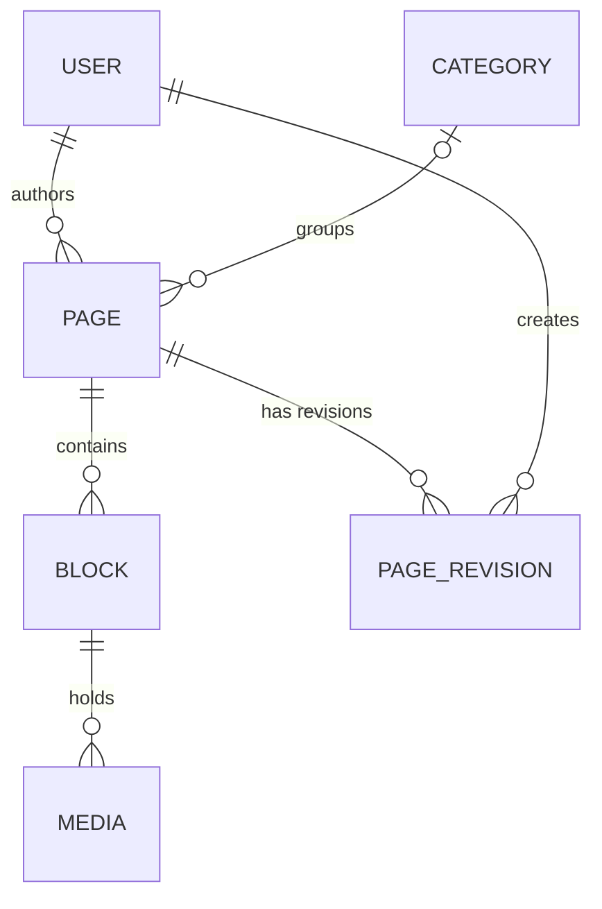

# CMS Backend API Documentation

## Overview

REST API of the CMS, built with Symfony 6.4. It provides:

- JWT authentication, registration and profile endpoints, with two roles (`ROLE_USER`, `ROLE_ADMIN`)
- Pages with SEO metadata, a publishing workflow and revision history
- Ordered content blocks per page (text, image, video, gallery, code, quote, html)
- Media metadata attached to blocks (the API stores URLs and metadata; it does not accept file uploads)
- Categories (admin-only writes)
- Pagination for page lists

## Architecture

### Entities
- **User** - Authentication and roles
- **Page** - Content pages with SEO fields
- **PageRevision** - Revision history for pages
- **Block** - Ordered content blocks of a page
- **Media** - Media metadata attached to a block
- **Category** - Page categorization

### Page Fields

#### SEO
- `metaTitle` - Custom meta title
- `metaDescription` - Meta description (max 500 chars)
- `metaKeywords` - Array of keywords
- `ogTags` - Open Graph tags for social sharing
- `isIndexable` - Search engine indexing flag

#### Publishing Workflow
- `status` - draft, published, archived, scheduled
- `publishAt` - Optional start of the publication window
- `unpublishAt` - Optional end of the publication window
- `Page::isPublished()` applies these rules; see [List Public Pages](#list-public-pages)

#### Templates
- `template` - page, post, landing, custom (stored with the page; the dashboard does not render pages)

#### Revisions
- A `PageRevision` is stored on every create and update
- Optional `changeNote` on update
- Stores the title, content and a JSON snapshot of the blocks
- Revisions can be read through the API; there is no restore endpoint

## API Endpoints

### Errors

Errors answer JSON with an `error` message, or an `errors` list for validation failures:

- `400` - the body of a `POST`, `PUT` or `PATCH` request is not a JSON object, or the data is invalid
- `401` - missing or invalid JWT; `403` - not allowed; `404` - not found or not visible to the caller
- `409` - the email is already used by another account (registration or profile update)

### Authentication

#### Register
```http
POST /api/register
Content-Type: application/json

{
  "email": "user@example.com",
  "password": "<your-password>",
  "firstName": "John",
  "lastName": "Doe"
}
```

#### Login
```http
POST /api/login
Content-Type: application/json

{
  "email": "user@example.com",
  "password": "<your-password>"
}
```
**Response:** JWT token

#### Get Profile
```http
GET /api/profile
Authorization: Bearer {token}
```

#### Update Profile
```http
PUT /api/profile
Authorization: Bearer {token}
Content-Type: application/json

{
  "firstName": "Jane",
  "lastName": "Smith"
}
```

---

### Pages

#### List Pages (with pagination)
```http
GET /api/pages?page=1&limit=10
```
Returns the pages the caller may see, paginated:
- anonymous: only pages that are public right now (see below)
- authenticated user: public pages plus their own pages in any status
- `ROLE_ADMIN`: all pages

Response: `{"data": [...], "total": 12, "page": 1, "limit": 10, "totalPages": 2}`

#### List Public Pages
```http
GET /api/pages?status=published
```
Returns the content that is public **right now**, the same list for every caller (anonymous, user or admin):
pages with status `published` or `scheduled` whose publication window is open
(`publishAt` empty or in the past, and `unpublishAt` empty or in the future).

- Pagination is ignored: `page` and `limit` have no effect and all public pages are returned.
- Response: `{"data": [...], "total": 3}` (no `page`, `limit` or `totalPages`).
- Any other `status` value is ignored and the request behaves like the paginated list above.

#### Get Single Page
```http
GET /api/pages/{id}
```
Pages that are not public right now are only visible to their author and admins.
For anyone else they answer **404 Not Found** (not 403), so their existence is not revealed.
The same applies to the blocks and media of hidden pages (`GET /api/blocks/{id}`, `GET /api/media/{id}`,
and `GET /api/media` leaves them out).

#### Create Page
```http
POST /api/pages
Authorization: Bearer {token}
Content-Type: application/json

{
  "title": "My Awesome Page",
  "slug": "my-awesome-page",
  "content": "Page content here",
  "status": "draft",
  "categoryId": 1,
  "metaTitle": "My Awesome Page - Best CMS",
  "metaDescription": "This is the best page about CMS systems",
  "metaKeywords": ["cms", "symfony", "vue"],
  "ogTags": {
    "og:image": "https://example.com/image.jpg",
    "og:type": "article"
  },
  "template": "page",
  "publishAt": "2025-10-10T10:00:00+00:00",
  "isIndexable": true
}
```

#### Update Page (with revision)
```http
PUT /api/pages/{id}
Authorization: Bearer {token}
Content-Type: application/json

{
  "title": "Updated Title",
  "content": "Updated content",
  "changeNote": "Fixed typos and updated SEO"
}
```

#### Delete Page
```http
DELETE /api/pages/{id}
Authorization: Bearer {token}
```

#### Get Page Revisions
```http
GET /api/pages/{id}/revisions
Authorization: Bearer {token}
```
Only the page author and admins can read revisions; anyone else gets 404.

#### Get Specific Revision
```http
GET /api/pages/{pageId}/revisions/{revisionId}
Authorization: Bearer {token}
```

---

### Blocks

#### Get Block
```http
GET /api/blocks/{id}
Authorization: Bearer {token}
```

#### Create Block
```http
POST /api/blocks
Authorization: Bearer {token}
Content-Type: application/json

{
  "type": "text",
  "content": "Block content here",
  "pageId": 1,
  "position": 0,
  "settings": {
    "alignment": "center",
    "fontSize": "large"
  }
}
```

**Block Types:** `text`, `image`, `video`, `gallery`, `code`, `quote`, `html`

#### Update Block
```http
PUT /api/blocks/{id}
Authorization: Bearer {token}
Content-Type: application/json

{
  "content": "Updated content",
  "position": 1
}
```

#### Delete Block
```http
DELETE /api/blocks/{id}
Authorization: Bearer {token}
```

---

### Media

#### List Media
```http
GET /api/media
Authorization: Bearer {token}
```

#### Create Media
```http
POST /api/media
Authorization: Bearer {token}
Content-Type: application/json

{
  "filename": "image.jpg",
  "type": "image",
  "url": "/uploads/image.jpg",
  "blockId": 1,
  "mimeType": "image/jpeg",
  "size": 102400,
  "alt": "Description"
}
```

#### Update Media
```http
PUT /api/media/{id}
Authorization: Bearer {token}
```

#### Delete Media
```http
DELETE /api/media/{id}
Authorization: Bearer {token}
```

---

### Categories

#### List Categories
```http
GET /api/categories
```

#### Create Category (Admin only)
```http
POST /api/categories
Authorization: Bearer {token}
Content-Type: application/json

{
  "name": "Technology",
  "slug": "technology",
  "description": "Tech articles"
}
```

#### Update Category (Admin only)
```http
PUT /api/categories/{id}
Authorization: Bearer {token}
```

#### Delete Category (Admin only)
```http
DELETE /api/categories/{id}
Authorization: Bearer {token}
```

---

## Security & Access Control

### Public Endpoints
- `GET /api/pages` - List pages (anonymous callers only get public content)
- `GET /api/pages/{id}` - View single page (hidden pages answer 404)
- `GET /api/categories`, `GET /api/categories/{id}` - Categories
- `POST /api/register` - Registration (always creates a `ROLE_USER` account; roles in the request are ignored)
- `POST /api/login` - Login

Sending a JWT to the public page endpoints also returns the caller's own drafts (all pages for admins).

### Authenticated Endpoints
- Every other endpoint requires a JWT (`Authorization: Bearer {token}`)
- Users can only edit/delete their own pages
- `ROLE_ADMIN` can edit/delete any content

### Authorization Rules
- **Pages**: Author or Admin can edit/delete; drafts and pages outside their publication window are visible to Author or Admin only
- **Blocks**: Page author or Admin
- **Media**: Block's page author or Admin
- **Categories**: Admin only for create/update/delete

---

## Database Schema


